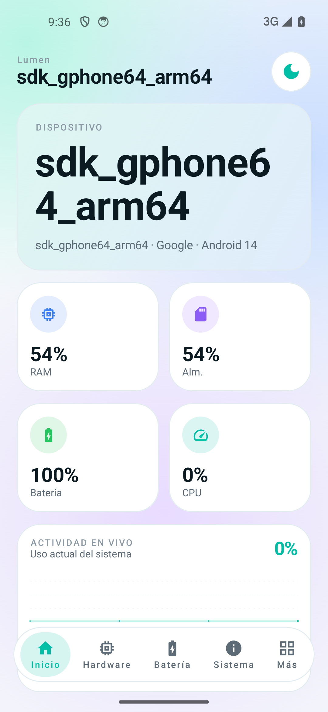
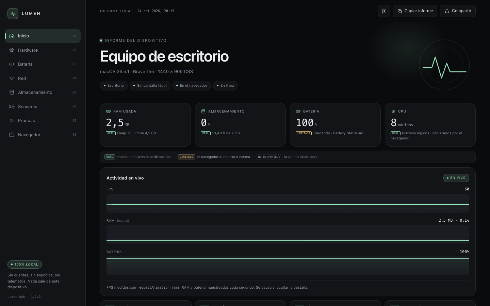
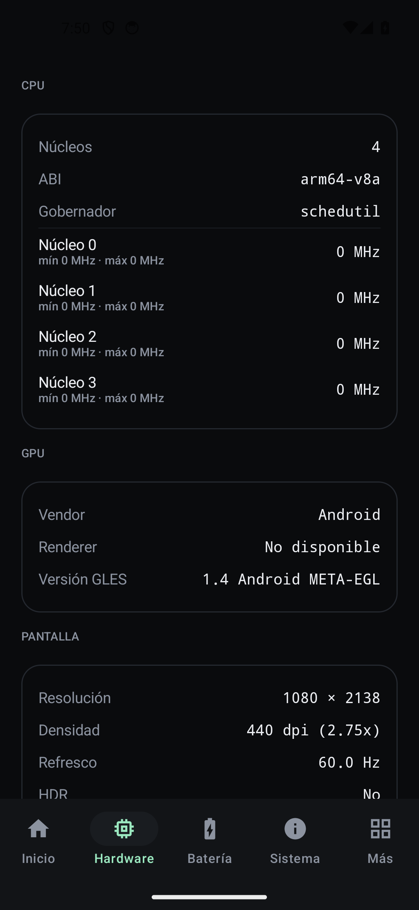

# Lumen — Device & System Info

Una alternativa minimalista a las apps de información del dispositivo: **app Android nativa** + **web app (PWA)**.
Sin anuncios, sin cuentas, sin telemetría y sin llamadas de red: todo se lee en tu dispositivo.

Inspirado en la información que ofrece [DevCheck](https://play.google.com/store/apps/details?id=flar2.devcheck),
con una interfaz propia más limpia.

## Qué incluye

### Android (Kotlin · Jetpack Compose · Material 3)
- **Inicio**: dispositivo, SoC, versión de Android y métricas en vivo (RAM, almacenamiento, batería, CPU).
- **Hardware**: núcleos y frecuencias por núcleo, GPU (EGL), pantalla, memoria, almacenamiento, cámaras, Bluetooth.
- **Batería**: nivel, estado, salud, temperatura, voltaje, corriente, potencia e historial.
- **Sistema**: Android/SDK, parche de seguridad, kernel, build, uptime, ABIs, locale.
- **Red**: transporte, operador, SIM, IPs, DNS, MTU y señal.
- **SIM y eSIM**: compatibilidad eUICC, ranuras, SIMs activas y operador (permiso bajo demanda).
- **Salud de batería**: SoH estimado, capacidad de diseño vs. estimada, ciclos e historial persistente.
- **Sensores**: lista con fabricante, tipo y valores en vivo.
- **Apps**: lista buscable con iconos, versión, targetSdk y tamaño del APK.
- **Tests**: benchmark de CPU (1 hilo / multihilo), memoria y almacenamiento.

### Web (HTML/CSS/JS · PWA)
- Misma identidad visual y estructura, usando las APIs reales del navegador.
- Cada dato marcado como **REAL**, **LIMITADO** o **NO DISPONIBLE**, con el motivo visible.
- **Pruebas reales**: CPU 1 hilo y multihilo (Web Workers), memoria, almacenamiento (IndexedDB) y GPU.
- Sensores en vivo con permiso, cámaras/micrófonos bajo demanda y monitoreo de FPS, batería, memoria y red.
- GPU vía WebGL/WebGPU, sensores con permiso explícito, almacenamiento estimado, UA-CH.
- Instalable como PWA, tema claro/oscuro, informe copiable/compartible.

## Diseño

Minimalismo oscuro: fondo casi negro, tarjetas con borde de 1 px, un único acento menta (`#9BE8C0`),
valores en tipografía monoespaciada e iconos vectoriales geométricos.

## Capturas

| Android | Web (escritorio) |
| --- | --- |
|  |  |
|  |  |

Web: <https://aurenox-global.github.io/lumen-device-info/>

## Estructura del repo

```
android/   App Android (Gradle + Compose)
web/       Web app estática (GitHub Pages)
shots/     Capturas de pantalla
lumen-debug.apk  APK de depuración listo para instalar
```

## Compilar la app Android

```bash
cd android
echo "sdk.dir=$HOME/Library/Android/sdk" > local.properties
./gradlew assembleDebug
# APK: app/build/outputs/apk/debug/app-debug.apk
```

Requiere JDK 17, Android SDK 35 y Gradle 8.11.1 (wrapper incluido). `minSdk 26`, `targetSdk 35`.

## Web en local

```bash
cd web
python3 -m http.server 8899
# http://localhost:8899
```

## Limitaciones

- Android no expone todos los datos a las apps: temperaturas internas, ciclos de carga o salud real de la
  batería suelen requerir root o Shizuku. Lumen muestra «No disponible» en lugar de inventar valores.
- La web solo puede leer lo que el navegador permite: no hay acceso a núcleos individuales, temperaturas,
  lista de apps ni sensores sin permiso. Los datos marcados como no disponibles dependen del navegador.
- `QUERY_ALL_PACKAGES` está pensado para uso personal/sideload; Google Play restringe ese permiso.

## Licencia

MIT.
